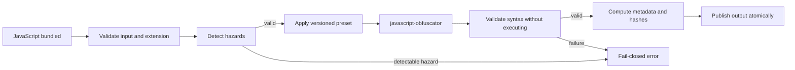
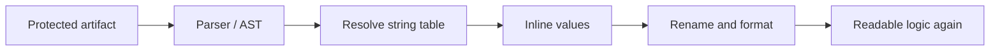

# js-condom

Build-time offline wrapper around `javascript-obfuscator` with a versioned preset, semantic
validation, and reproducible metadata.

This tool is an **operational wrapper**. It standardizes obfuscation defaults, validates supported
JavaScript subsets, and produces auditable artifacts. It is **not** a security boundary and does
**not** promise irreversibility, anti-LLM resistance, or measurable recovery cost.

## Project context and direction

We are building a build-time protection layer that runs locally and offline on top of a qualified
open-source engine. The MVP focuses on a single bundled JavaScript file and provides an API, a CLI,
and a versioned preset with consistent behavior.

### Why we are building it

The goal is to make protection predictable and auditable for teams producing JavaScript artifacts:

- reduce divergent project decisions through controlled defaults;
- preserve the semantics of the supported JavaScript subset;
- enable reproducible builds when a seed is fixed;
- record versions, configuration, seed, and hashes for diagnostics and audits;
- fail explicitly on incompatible inputs without publishing partial artifacts.

Previous investigation found insufficient evidence to promise resistance against automated
deobfuscation or LLMs. The expected outcome of this phase is therefore operational reliability, not
irreversibility. Any future claim about recovery cost must be measured in a separate adversarial
experiment with its own protocol and evidence.

### Expected MVP outcome

At the end of this phase, the project should provide:

1. a stable `protect(sourceCode, options)` function;
2. the `js-condom protect input.js --output protected.js` command for `.js`, `.mjs`, and `.cjs` files;
3. semantically equivalent output for officially supported fixtures;
4. reproducible bytes and hashes with a fixed seed;
5. enough metadata to reproduce and investigate a build;
6. structured errors, fail-closed behavior, and offline execution without telemetry;
7. CI and documentation for requalifying the engine before any upgrade.

Directories, source maps, bundler plugins, TypeScript/JSX, and new engines remain outside the MVP
and require their own decisions and specifications.

### Protection flow



## Recommended usage

The typical workflow is:

1. generate and bundle the application JavaScript;
2. run `js-condom` on the final artifact;
3. store the protected code and report with the build record;
4. retain `seedUsed`, `presetVersion`, and hashes for reproduction or diagnostics.

### CLI

After installing dependencies, protect a single file:

```bash
npm ci
node src/cli/protect.js protect dist/app.js \
  --output dist/app.protected.js \
  --report dist/app.protected.json \
  --seed release-2026-08-09
```

For reproducible builds, keep the same seed, package version, engine version, and preset. For
independent builds, omit `--seed`; the effective seed is recorded in the report.

### API

Use the API when the build pipeline is already controlled by Node.js:

```js
import { readFile, writeFile } from 'node:fs/promises';
import { protect } from './src/core/protect.js';

const source = await readFile('dist/app.js', 'utf8');
const result = await protect(source, { seed: 'release-2026-08-09' });

await writeFile('dist/app.protected.js', result.code, 'utf8');
await writeFile('dist/app.protected.json', `${JSON.stringify(result.metadata, null, 2)}\n`);
```

`js-condom` rejects unknown options and inputs outside the supported subset. On error, the CLI
returns a non-zero exit code and writes a JSON object to stderr. No artifact should be treated as
published when the operation fails.

## What the wrapper adds

When used with the same version, preset, and seed, `js-condom` uses the same transformation engine
as `javascript-obfuscator`. The value comes from the surrounding process:

- a controlled preset instead of divergent project flags;
- recorded seed, versions, configuration, and hashes;
- hazard and output validation before publication;
- one contract shared by the API and CLI;
- atomic writes, conflict prevention, and structured errors;
- CI gates, auditing, and offline execution.

This improves predictability, reproduction, and diagnostics. It is not an additional encryption
layer or proof of resistance against deobfuscation, manual analysis, or LLMs.

## Side-by-side: plain JS, engine only, and js-condom

The same input goes through three paths. Outputs are real but truncated with `…`. Running the
original and both js-condom outputs with `applyDiscount(100, 'gold')`, `(59.9, 'silver')` and
`(10, 'x')` returns `80`, `53.91` and `10`. The engine-only output was not executed.

**1. Plain JS** (193 bytes)

```js
export function applyDiscount(price, customerTier) {
  const rates = { gold: 0.2, silver: 0.1 };
  const rate = rates[customerTier] ?? 0;
  return Math.round(price * (1 - rate) * 100) / 100;
}
```

**2. Engine only** — `javascript-obfuscator` 4.1.0 with its default options

```js
function _0x9980(_0x340480,_0x59e850){const _0x41643f=_0x4164();return _0x9980=function(…){…},_0x9980(…);}
(function(_0xcd75a,_0x48fecf){…while(!![]){try{…parseInt(_0x38e788(0x193))…}catch(…){…}}}(_0x4164,0xf3380));
function _0x4164(){const _0xb1569c=['8UcMYgb',…,'round',…];…}
export function applyDiscount(_0x38f81a,_0x6339dc){const _0x1e4a4c=_0x9980,_0x578c22={'gold':0.2,'silver':0.1},
_0x3215fb=_0x578c22[_0x6339dc]??0x0;return Math[_0x1e4a4c(0x189)](_0x38f81a*(0x1-_0x3215fb)*0x64)/0x64;}
```

**3. js-condom** (preset `2.0.0`) — `js-condom protect input.mjs --output out.mjs --report out.json --seed <seed>`

`--seed seed-a` (3,017 bytes, `outputSha256` `56975f25…`):

```js
function _0x259b(_0x16920e,_0xf394e4){…if(_0x259b['ecWPLn']===undefined){var _0x14ae22=function(_0x498b94){
const _0x5b34c3='abcdefghijklmnopqrstuvwxyzABCDEFGHIJKLMNOPQRSTUVWXYZ0123456789+/=';…}…}
export function applyDiscount(_0x51596c,_0x11676c){const _0x2a2dbf=_0x259b,_0x19b549={};
_0x19b549[_0x2a2dbf(0x1e4)]=0.2,_0x19b549[_0x2a2dbf(0x1e0)]=0.1;const _0x4e8284=_0x19b549,
_0x5d63ae=_0x4e8284[_0x11676c]??-0x52*0x11+0x63*-0x25+-0x185*-0xd;return Math[_0x2a2dbf(0x1e9)](…)/(…);}
function _0x331b(){const _0x55cdc7=['n1r3BhHVEG','mtq0t1HxvMjY',…,'CM91BMq',…];…}
```

Running `seed-a` again produces the same bytes and hash. `--seed seed-b` produces a different
layout (3,097 bytes, `outputSha256` `88f53d63…`) with the same behavior:

```js
export function applyDiscount(_0x3dc390,_0x4e4c07){const _0x2804cc=_0x376e,_0x5887e2={};
_0x5887e2[_0x2804cc(0xca)]=0.2,_0x5887e2[_0x2804cc(0xcc)]=0.1;…return Math[_0x2804cc(0xcf)](…)/(…);}
function _0x56eb(){const _0x2cdb16=['mJC0ntG0nw1XrfvQAG','CM91BMq',…];…}
```

The `--report` file records the audit trail:

```json
{ "toolVersion": "0.0.0", "engineVersion": "4.1.0", "presetVersion": "2.0.0", "seedUsed": "seed-a",
  "inputSha256": "8cbccdaf…", "outputSha256": "56975f25…", "configSha256": "39ecd0bd…" }
```

Unsafe input is rejected before obfuscation. For example,
`export const f = (s) => eval(s);` fails with `UNSUPPORTED_SYNTAX` and `{ "hazard": "direct-eval" }`.

**How to read it**

- All three paths share the same engine. Paths 2 and 3 both rename identifiers, move strings
  into a shuffled table, and add a rotation bootstrap.
- Preset `2.0.0` goes further than the engine defaults:
  - every string goes into the table, instead of about 80% by default;
  - the table is base64-encoded, so `round` no longer appears in clear text;
  - object keys (`gold`, `silver`) are moved into the table;
  - integer literals (`1`, `100`) become arithmetic expressions.
- js-condom also adds controls around the engine:
  - a frozen, versioned preset;
  - byte-identical output for the same seed;
  - hazard rejection before protection;
  - SHA-256 audit metadata;
  - atomic writes that never overwrite existing files.
- Still visible: the export name `applyDiscount`, the decimal rates `0.2` and `0.1` (engine 4.1.0
  does not transform non-integer numbers), and the shape of the arithmetic. The base64 table is
  encoding, not encryption: the decoder ships in the same file. Obfuscation does not hide secrets
  or business rules.
- Size cost: 193 → 1,257 bytes with the engine defaults, and 193 → 3,017 bytes with preset
  `2.0.0`. Most of it is fixed decoder runtime, so the relative cost shrinks for larger files.

## Output and deobfuscation example

Consider this input code:

```js
export function greet(name) {
  return 'Hello, ' + name + '!';
}
```

With preset `1.0.0` and a fixed seed, the output contains hexadecimal names, a string table, and an
engine-generated decoder. Preset `2.0.0` also base64-encodes that table. The steps below still
apply, because the decoder ships in the same file. A representative excerpt of the current output is:

```js
function _0x5e01(_0x2a5f9d, _0x308dc7) {
  var _0x385af2 = _0x385a();
  return _0x5e01 = function (_0x5e0181, _0xf0dbdc) {
    _0x5e0181 = _0x5e0181 - 0x1de;
    return _0x385af2[_0x5e0181];
  }, _0x5e01(_0x2a5f9d, _0x308dc7);
}

// string table and bootstrap omitted in this example

export function greet(_0x49708f) {
  var _0x2969d5 = _0x5e01;
  return _0x2969d5(0x1e6) + _0x49708f + '!';
}
```

This format makes casual reading harder, but it does not permanently hide the logic. A typical
deobfuscation process can:

1. parse the AST and locate the string table;
2. execute or statically evaluate the decoder;
3. replace calls such as `_0x2969d5(0x1e6)` with the corresponding text;
4. rename identifiers and reformat the code;
5. compare the result with the behavior of the original artifact.

After these steps, the essential logic can return to a form close to:

```js
export function greet(name) {
  return 'Hello, ' + name + '!';
}
```



Therefore, `js-condom` is expected to make casual reading harder and standardize the build, not
prevent reverse engineering. Recoverability depends on the program, preset, engine, and tools used
by the analyst. This repository does not publish a recovery rate, recovery time, or advantage
against LLMs; any such number requires a separate, reproducible adversarial benchmark.

## Requirements

- Node.js **24 LTS** (verified in CI)

## Installation

```bash
npm ci
```

The CLI is exposed as `js-condom` via the package `bin` field.

## API

```js
import { protect } from './src/core/protect.js';

const { code, metadata } = await protect(sourceCode, { seed: 'optional-seed' });
```

### Options

| Option | Type | Description |
|--------|------|-------------|
| `seed` | `string` (optional) | When omitted, a random seed is generated and returned in metadata. When set, output bytes and hashes are reproducible for the same input, preset, and engine version. |

### Result

```js
{
  code: string,
  metadata: {
    toolVersion: string,
    engineVersion: string,   // qualified javascript-obfuscator version
    presetVersion: string,   // e.g. "2.0.0"
    seedUsed: string,
    inputSha256: string,
    outputSha256: string,
    configSha256: string,
  }
}
```

Unknown options are rejected with `INVALID_CONFIG`. The public API does not expose raw engine flags.

## Error Taxonomy

All errors surfaced by the API or CLI use one of the canonical, standardized codes:

| Error Code | Meaning | Example Trigger |
|---|---|---|
| `INVALID_INPUT` | Input source code or CLI arguments are invalid | Empty string, non-JS extension, missing `--output` |
| `INVALID_CONFIG` | Provided configuration options are invalid | Unknown option keys, empty seed string |
| `UNSUPPORTED_SYNTAX` | JavaScript syntax is invalid or uses `eval` / `with` | Syntax error, `eval()`, `with (...)` |
| `SEMANTIC_HAZARD` | Code uses constructs that break under obfuscation | `new Function()`, `fn.toString()`, `Function.prototype.toString.call(fn)` |
| `PROTECTION_FAILED` | Obfuscation engine failed, or the protected output is not valid JavaScript | Engine exception, protected code that does not parse |
| `OUTPUT_CONFLICT` | Target output or report path collides with input or exists | Target file already exists on disk |
| `INTERNAL_ERROR` | Unexpected internal exception | Uncaught filesystem error while publishing the output |

Errors output to `stderr` are strictly sanitized: secrets, tokens, passwords, and source code fragments are filtered out.

## CLI

Protect a single JavaScript file:

```bash
js-condom protect input.js --output protected.js
```

Supported extensions: `.js`, `.mjs`, `.cjs`.

Optional flags:

```bash
js-condom protect input.mjs --output out.mjs --report report.json --seed my-seed
```

- `--output` is required.
- `--report` writes JSON metadata atomically when provided.
- Errors are written to stderr as structured JSON; exit code is non-zero on failure.
- Output paths must not collide with the input or existing files (fail closed).

## Security and Hardening Guarantees

1. **Deterministic Hashes:** `configSha256` is computed by recursively sorting object keys in the config tree, ensuring identical seeds and preset versions always yield matching configuration hashes across platforms.
2. **Fail-Closed Atomic Writes:** Outputs and reports are written to temporary files (`.${filename}.${randomHex}.tmp`) and published with a hard link that fails if the target already exists. Only files this run published are removed if a later step fails.
3. **Recursive Detail Sanitization:** Error details stripped of source code, API keys, passwords, and tokens up to 4 levels of object depth.
4. **AST-Based Hazard Detection:** Detection of `with`, `eval`, `Function`, and `toString` dependencies operates on parsed Acorn AST nodes rather than naive regex, eliminating false positives on comments and strings.
5. **No Host Execution:** `protect()` validates the artifact by parsing it. It does not import or execute that code in the build process. Semantic checks of fixtures run in a separate subprocess during tests, not during publication.

## Preset v2

The preset is versioned as a single unit (`presetVersion: 2.0.0`). It encapsulates approved
`javascript-obfuscator` options:
- `compact: true` (minified bundle)
- `identifierNamesGenerator: 'hexadecimal'` (stable renaming)
- `stringArray: true` & `stringArrayShuffle: true` (string table extraction with seed)
- `stringArrayThreshold: 1` (every string goes to the table; the engine default leaves ~20% inline)
- `stringArrayEncoding: ['base64']` (table entries are not stored as clear text)
- `transformObjectKeys: true` (object literal keys move into the table)
- `numbersToExpressions: true` (integer literals become expressions; decimals stay visible)
- `simplify: true`
- `controlFlowFlattening: false` & `deadCodeInjection: false` (disabled to preserve runtime performance and stability)
- `selfDefending: false` (disabled to avoid runtime traps in legitimate environments)
- `renameGlobals: false` (disabled to preserve cross-module and global compatibility)

Upgrading from preset `1.0.0` changes the output bytes and `configSha256` for the same input and
seed. Reports carry `presetVersion`, so they show which preset produced an artifact.

Consumers cannot pass arbitrary engine flags. Qualified engine: `javascript-obfuscator@4.1.0` (see `package.json` → `jsCondom`).

## Seed behavior

- **Fixed seed:** same input + preset + engine version → identical output bytes and hashes.
- **Omitted seed:** `seedUsed` in metadata contains the effective seed (not a secret).
- Seeds are for reproducibility and audit trails, not confidentiality.

## Engine requalification policy

Any change to the qualified engine version or preset requires:

1. Re-run the full semantic fixture matrix (`npm test`).
2. Update `jsCondom.qualifiedEngineVersion` and/or `presetVersion` in `package.json`.
3. Record new reference hashes in the [release checklist](docs/release-checklist.md).
4. Security review of dependency changes (`npm audit --audit-level=high`).

Do not ship engine or preset upgrades without completing the checklist.

## Limitations

- **Single file only** — no directories, source maps, or bundler plugins in v1.
- **JavaScript only** — no TypeScript, JSX, or TSX.
- **Supported subset** — exercised by the release fixture matrix (ESM/CJS, async/await, classes,
  closures, generators, optional chaining, private fields, exceptions).
- **Rejected hazards (when detectable):** `eval`, `with`, `Function` constructor, and
  `function.prototype.toString` dependencies on function references. Any value reference to
  `eval` or `Function` is rejected, including aliases, `(0, eval)(...)`,
  `globalThis.Function` and `Reflect.construct(Function, ...)`; `x instanceof Function` and
  `Function.prototype.<member>` remain allowed.
- **Not detected:** code creation reached through runtime values, such as
  `(() => {}).constructor("...")` or property names built at runtime.
- **Best-effort detection** — dynamic patterns not visible to static analysis are documented
  limitations, not guarantees.
- **No browser runtime** — protection runs in Node.js at build time.
- **No network or telemetry** during protection.

## Privacy

Input and output remain in the local process. The tool does not send source code, metadata, or
artifacts to external services during protection.

## Code Reviews and Audits

- [2026-08-27 Code Review, Hardening & Security Analysis](docs/reviews/2026-08-27-js-condom-code-review-and-hardening.md)
- [2026-08-09 Spec and ADR Review](docs/reviews/2026-08-09-js-condom-spec-adr-review.md)

## Development

```bash
npm run lint    # ESLint (recommended rules) on all sources and tests
npm test        # full test suite including offline boundary tests
npm audit --audit-level=high
```

See [docs/release-checklist.md](docs/release-checklist.md) before tagging a release.
